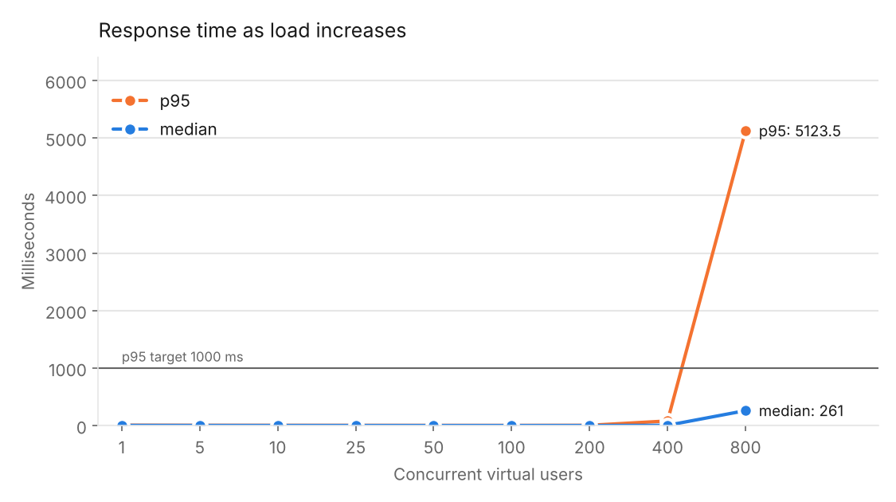
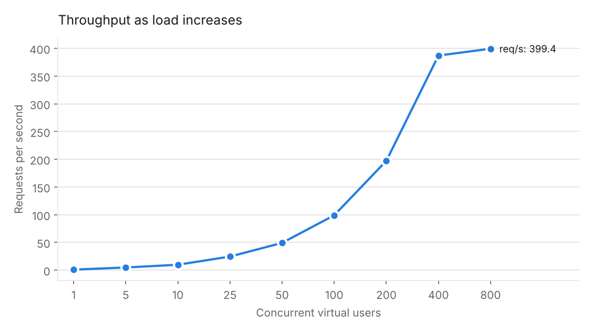
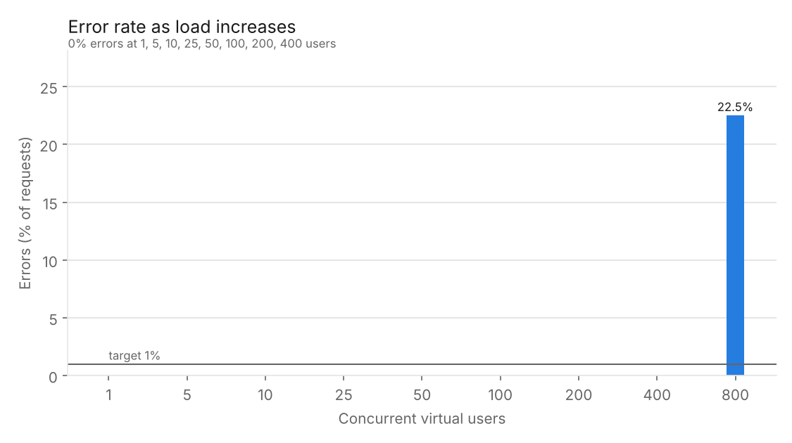

# PyTodo Pro - Week 5 security and performance

**Course:** TEB3433 / TFB3433 Software Testing and Quality Assurance, September 2026
**Assignment stage:** Week 5 - Security and performance testing
**Report date:** 2026-11-25 (Asia/Kuala_Lumpur)
**Team:** see the project README.
**Execution provenance:** STRIDE table by Ahmad Adam Ali. Code review, Group performance run on Windows: `11` (Adam Ali/ 26/11/2026).

## 1. Scope

The brief asks for a simple STRIDE-oriented threat table, safe security test cases derived from it (no uncontrolled penetration testing), and a controlled performance experiment with a defined workload and environment, measured response time, throughput and error rate, behaviour as load increases, and stated limitations.

The supplied app is not changed. Every test server checks the original `app.py` hash (`050b4ee4...`), runs only on 127.0.0.1 and uses a temporary database.

## 2. STRIDE threat table

**What we modelled:** a browser talks to the Flask app (web pages and the `/api` JSON endpoints), which stores data in one SQLite file. The trust boundary is between the browser and the server: everything the browser sends is untrusted. **Assets:** user accounts and passwords, the login session, and task data. **Entry points:** registration, login, logout, the task pages and forms, and the API endpoints. There is no admin role, so "elevation of privilege" here means one user acting on another user's data.

| ID | STRIDE | Component | Threat | Impact | Mitigation |
|---|---|---|---|---|---|
| S-01 | Spoofing | Login sessions | Session-signing key is hard-coded in `app.py` (line 28) | **High:** anyone with the source code could pose as any user | Load the key from an environment variable and change it |
| S-02 | Spoofing | Login (`/login`, `/api/login`) | No limit on failed login attempts | **High:** passwords can be guessed repeatedly | Add rate limiting or account lockout |
| S-03 | Spoofing | Registration | Duplicate usernames accepted (P-03, WEB-02, API-37) | **Medium:** a username doesn't identify one person; second account may be unable to log in | Make usernames unique |
| S-04 | Spoofing | Logout | Logging out doesn't invalidate a copied session cookie | **Low:** only matters if a cookie is stolen first | Server-side sessions or short session lifetime |
| T-01 | Tampering | API search (`/api/tasks?q=`) | Search text is pasted straight into the SQL query (line 379) | **High:** task and user data could be read or changed | Use a bound parameter, like the web search does |
| T-02 | Tampering | Task create/update | Missing server-side input checks (DEF-W1-004, DEF-W4-001, DEF-W4-002) | **Medium:** blank or invalid tasks saved; requests crash | Validate input on the server for web and API |
| T-03 | Tampering | Web forms | No CSRF tokens; logout uses GET | **Medium:** another site could trigger actions for a logged-in user | Add CSRF tokens; use POST for logout |
| R-01 | Repudiation | All task changes | No record of who created, changed or deleted what | **Medium:** actions can't be traced to a user | Add an audit log (user, time, action) |
| I-01 | Information disclosure | Running the app | `debug=True` (line 482) shows detailed error pages | **High:** exposes code and configuration on errors | Turn debug off; show generic error pages |
| I-02 | Information disclosure | Task list page | Titles displayed without HTML escaping (`\|safe`, index.html line 44) | **Medium:** script in a title would run in the page (limited because users only see their own tasks) | Remove `\|safe` |
| I-03 | Information disclosure | Network | No HTTPS; cookie not marked Secure | **Medium:** login details readable in transit if deployed | Use HTTPS and secure cookie flags |
| I-04 | Information disclosure | Password storage | Passwords exposed if the database leaks | **Low:** passwords are already hashed (control works) | No change needed |
| D-01 | Denial of service | Task creation (API) | Invalid due date is saved and breaks the task list (DEF-W4-003) | **High:** the user's task list and dashboard stop working | Validate dates before saving |
| D-02 | Denial of service | Whole app | No rate or size limits; dev server and SQLite handle little load | **Medium:** app slows or fails under heavy use | Production server, rate limits, input size limits |
| E-01 | Elevation of privilege | API delete (`DELETE /api/tasks/<id>`) | Any logged-in user can delete another user's task (DEF-W1-003) | **High:** other users' data lost | Restrict delete to the task's owner |
| E-02 | Elevation of privilege | Protected pages and API | Using the app without logging in | **Low:** login is required everywhere (control works) | No change needed |
| E-03 | Elevation of privilege | Other task routes (view, edit, toggle, web delete) | Acting on another user's task | **Low:** these routes check the owner (control works) | No change needed |

The table follows the four STRIDE steps from the STQA08 lecture: decompose the app (above), find threats per category, choose a mitigation (most are standard mitigations; the three Low rows are accepted because the control already works), and validate (section 3).

## 3. Security test cases and findings

**Approach.** Each STRIDE row is backed by one of three kinds of evidence:
1. **Executed tests from earlier weeks** that already exercise the threat. They are not repeated here; Week 5 links them to the threat model.
2. **Code review (static analysis, SAST in the lecture)** of `app.py` and the templates. These findings are confirmed by reading the code, not by a running test.
3. **Planned controlled checks** for rows that still need a running test. These are for the team to design and run on the isolated local copy only, with dummy accounts, and agreed with the lecturer first. Nothing in this stage was tested against any site other than the local copy.

| STRIDE row | Evidence type | Test / evidence | Result | Defect / finding |
|---|---|---|---|---|
| E-01 | Executed test | Week 4 API-25 (2026-11-12): another user's DELETE | Fail: task deleted, HTTP 200 | DEF-W1-003 (Major / High, open) |
| E-02 | Executed tests | TC-BB-010; Week 4 API-02, API-15, API-38; Week 6 AUTO-API-007, AUTO-WEB-005 | Pass: login required (401 or redirect) | Control works |
| E-03 | Executed tests | Week 4 API-52, API-53 (other user's GET/PUT), WEB-20 (edit page); TC-BB-018 | Pass: other users refused | Control works |
| D-01 | Executed tests | Week 4 API-49, API-50 | Fail: invalid date saved; list then fails | DEF-W4-003 (Major / High, open) |
| T-02 | Executed tests | TC-BB-014; Week 4 API-32, API-42 | Fail | DEF-W1-004, DEF-W4-001, DEF-W4-002 (Moderate / Medium, open) |
| S-03 | Executed tests | API probe P-03; Week 4 WEB-02, API-37 | Duplicates accepted | Open question: uniqueness policy not yet agreed |
| D-02 | Executed test | Week 5 performance experiment (section 5) | Targets met up to 400 users; at 800 users 22.5% errors | DEF-W5-001 (Moderate / Low, open) |
| S-01 | Code review | `app.py` line 28: `SECRET_KEY = "pytodo-pro-dev-secret"` | Key is in the source | CR-01 |
| T-01 | Code review | `app.py` line 379: search text inserted into the SQL string; the web search (line 211) and all other queries use `?` parameters | String-built query | CR-02 |
| I-01 | Code review | `app.py` line 482: `app.run(debug=True)` | Debug on when started normally | CR-03 |
| I-02 | Code review | `templates/index.html` line 44: `{{ t.title\|safe }}` | Escaping turned off for titles | CR-04 |
| S-02 | Code review | Login routes (lines 164-176, 334-344): no attempt counter, delay or lockout | No limit found | CR-05 |
| T-03 | Code review | No CSRF token field in any form; `/logout` accepts GET (line 179) | No CSRF protection found | CR-06 |
| R-01 | Code review | No logging of task changes anywhere in `app.py` | No audit trail | CR-07 |
| I-03, S-04 | Code review | No HTTPS or cookie settings in `app.py`; sessions are Flask's default browser cookies | Defaults only | CR-08 |
| I-04 | Code review | `generate_password_hash` (lines 151, 325) stores salted scrypt hashes, the Werkzeug default | Control works | - |
| S-02, I-02, T-01, I-04 | **Planned controlled check (team)** | Run on the isolated copy (Week 3/4 server, port 5013/5014) with dummy accounts | Not run yet | Confirms or rejects CR-02, CR-04, CR-05 at run time |

**Code-review findings.** These are recorded separately from runtime defects so they don't inflate the confirmed defect count, the same way Week 4 separated confirmed defects from assumptions.

| ID | Finding | Suggested severity / priority | Status |
|---|---|---|---|
| CR-01 | Hard-coded session-signing key | Major / High | Open: confirmed in code |
| CR-02 | API search builds SQL by inserting user text | Major / High | Open: confirmed in code; runtime check planned |
| CR-03 | Debug mode on when run as supplied | Major / High | Open: confirmed in code |
| CR-04 | Task titles rendered without escaping | Moderate / Medium | Open: confirmed in code; runtime check planned |
| CR-05 | No limit on failed logins | Moderate / Medium | Open: confirmed in code; runtime check planned |
| CR-06 | No CSRF tokens; logout by GET | Moderate / Medium | Open: confirmed in code |
| CR-07 | No audit log of changes | Minor / Low | Open: confirmed in code |
| CR-08 | No HTTPS / secure cookie settings; no server-side session end | Minor / Low (local use); higher if deployed | Open: confirmed in code |

## 4. Performance test design

### 4.1 Objective

Find out how response time, throughput and error rate change as the number of simultaneous users grows, on the pages a signed-in user uses most, and find the level where the app stops meeting reasonable targets (stress).

### 4.2 Busy pages and endpoints selected

| Request | Why it was chosen |
|---|---|
| `GET /` task list page | The page every user sees after login and after every action. It loads all of the user's tasks with no paging and looks up each task's category separately. |
| `GET /dashboard` | Reads all the user's tasks and works out urgency for each one. |
| `GET /api/tasks` | Main API read (10 tasks per page by default). |
| `POST /api/tasks` | The only write in the loop. SQLite allows one writer at a time, so writes are the likely bottleneck. |
| `POST /register` | Once per virtual user. Reported separately because password hashing (scrypt) is deliberately slow. |

### 4.3 Workload (defined before execution)

| Setting | Value |
|---|---|
| Tool | Apache JMeter 5.6.3, command line (non-GUI), plan `performance/pytodo_load_test.jmx` |
| Virtual user flow | Register a new account once; then repeat: task list → dashboard → API task list → API create task (title, description, due date 5 days ahead) |
| Think time | Random 0.5-1.5 s before each request (about 1 request per second per user) |
| Load levels | **Load test** (expected use of a small team): 1, 5, 10, 25 users. **Stress test**: 50, 100, 200, 400, 800 users |
| Ramp-up | 5 s, or users ÷ 5 s if longer (50 users: 10 s; 800 users: 160 s) |
| Measured window | 60 s of steady state after ramp-up (ramp-up excluded) |
| Repeats | 3 runs per level (2 for 400 and 800 in the agent run); results averaged; p95 range shown |
| Isolation | Fresh server and empty database for every run; port 5015; debug off; same Flask built-in server that `python app.py` uses |
| Recovery check | Highest level, then 1 user on the same server straight after (done for 200 and for 800 users) |
| Pass/fail rule | Each request checked: page/API reads must return 200, create 201, registration must reach "My Tasks" |
| Targets (proposed; the brief gives none) | p95 response time ≤ 1000 ms and errors ≤ 1% |

Due dates are always valid, so DEF-W4-003 cannot break the test users' task lists during the run. The error rate therefore measures load problems only.

### 4.4 Environment

These numbers come from a small cloud workspace and must be replaced by a group PC run (see section 7).

| Item | Value |
|---|---|
| Computer | Linux workspace (Ubuntu 24.04), Intel Xeon @ 2.30 GHz, **2 logical CPUs**, 7.8 GB RAM |
| Software | Python 3.13.18, Flask 3.0.3 (the app's pinned version), Werkzeug 3.1.9, Apache JMeter 5.6.3, OpenJDK 21.0.13 |
| Server | Flask built-in server, threaded, debug off, 127.0.0.1:5015, fresh SQLite database per run |
| App under test | Unchanged: `app.py` SHA-256 `050b4ee4...`, `helpers.py` `bf914033...` |
| Dates | 2026-11-25, 18:27-19:17 (UTC+08:00) |
| Evidence | Combined analysis: `evidence/perf_20261125-agent-run-combined/` (all 9 levels). Raw runs: `evidence/perf_20261125-182754_agent-run/` (1-200 users, 3 runs each) and `evidence/perf_20261125-185954_agent-run-stress-extension/` (400 and 800 users, 2 runs each) |

## 5. Performance results

### 5.1 Results by load level

Page and API requests in the 60 s steady-state window, averaged over the runs at each level. Registration is shown separately because it happens once per user and is slow by design.

| Users | Test type | Runs | Requests measured | Median (ms) | p95 (ms) | Throughput (req/s) | Errors (%) | Meets targets | Registration median / p95 (ms) |
|---:|---|---:|---:|---:|---:|---:|---:|---|---|
| 1 | Load | 3 | 174 | 4 | 8 | 1.0 | 0 | Yes | 104 / 121 |
| 5 | Load | 3 | 870 | 3 | 6.3 | 4.8 | 0 | Yes | 68 / 116 |
| 10 | Load | 3 | 1,769 | 2.7 | 5.7 | 9.8 | 0 | Yes | 71 / 114 |
| 25 | Load | 3 | 4,416 | 2.3 | 5.3 | 24.5 | 0 | Yes | 74 / 100 |
| 50 | Stress | 3 | 8,861 | 2 | 4.7 | 49.2 | 0 | Yes | 68 / 97 |
| 100 | Stress | 3 | 17,814 | 2 | 4.3 | 99.0 | 0 | Yes | 68 / 103 |
| 200 | Stress | 3 | 35,496 | 2 | 6.3 | 197.2 | 0 | Yes | 68 / 99 |
| 400 | Stress | 2 | 46,457 | 6 | 81.5 | 387.1 | 0 | Yes | 76 / 187 |
| 800 | Stress | 2 | 47,924 | **261** | **5,123.5** | **399.4** | **22.5** | **No** | 124 / 5,290 (7.9% failed) |

The p95 varied little between repeats (for example 78-85 ms at 400 users and 5,098-5,149 ms at 800); every run is listed in `results.md`.

### 5.2 Results by page (p95 in ms; errors in brackets)

| Users | Task list page | Dashboard page | API list tasks | API create task |
|---:|---:|---:|---:|---:|
| 1 | 5.3 | 5.3 | 4.7 | 14.3 |
| 25 | 3.7 | 3.3 | 3.3 | 6.7 |
| 200 | 7.3 | 5.3 | 5 | 7.3 |
| 400 | 102.5 | 62 | 58 | 106 |
| 800 | 1,898.5 (14.8%) | 1,348.5 (14.7%) | 1,339 (14.6%) | **5,402.5 (45.8%)** |

### 5.3 Recovery check

| Sequence on one server | 1-user median / p95 afterwards (ms) | Errors afterwards | Baseline 1 user (median / p95) |
|---|---|---|---|
| 200 users, then 1 user | 4 / 8 | 0% | 4 / 8 |
| 800 users (14.9% errors), then 1 user | 4 / 7 | 0% | 4 / 8 |

### 5.4 Interpretation

1. **Expected load (1-25 users): comfortably within targets.** Median 2-4 ms, p95 at most 8 ms, no errors. Throughput rises in step with users (about 1 request per second per user), so the server keeps up with everything offered.
2. **Up to 200 users: still no strain.** Throughput reaches 197 req/s, matching what the users send, and p95 stays under 10 ms.
3. **400 users: the limit is near.** Throughput (387 req/s) still roughly matches demand, but p95 rises about 13 times to around 80 ms, and the slowest request takes over a second. Requests have started to queue. Targets are still met.
4. **800 users: breaking point.** Throughput stops rising at about **400 req/s**, the capacity of this setup, while users send about twice that. Requests queue, the median rises to 261 ms, p95 reaches about 5.1 s, and **22.5% of requests fail**.
5. **Why it fails: the database lock.** The server log shows the same error for every failure: `sqlite3.OperationalError: database is locked` (about 3,000 per 800-user run: 3,037 and 3,148), on the task INSERT (`app.py` line 413) and on registration. SQLite allows one writer at a time. Python's sqlite3 waits up to 5 seconds for the lock and then gives up, which matches the p95 of about 5.1 s. The app does not handle the error, so the user gets **HTTP 500** and the task is not saved (45.8% of creates failed). 7.9% of registrations failed the same way. Those virtual users never got a session, and they caused nearly all the read-page errors (302 redirects to login and 401s).
6. **Recovery: full.** As soon as the load dropped, a single user got normal response times (4 ms median) with no errors. The overload left no lasting damage.
7. **Slowest normal operation: registration** (about 70-100 ms median), because password hashing (scrypt) is deliberately slow. That is a security feature, not a defect.

**Capacity on this computer:** between 400 and 800 simultaneous active users (about 400 requests per second), far above the expected load of a small team. A faster PC will have a higher limit; the cause (one SQLite writer at a time) will not change.

### 5.5 New defect

**DEF-W5-001 Concurrent writes fail with HTTP 500 ("database is locked") under heavy load**

- **Affected feature:** task creation and registration (R-04, R-01, R-12); STRIDE row D-02.
- **Environment:** section 4.4; isolated server on port 5015; JMeter plan `pytodo_load_test.jmx`.
- **Preconditions:** fresh database; 800 virtual users, each registering then looping as in section 4.3.
- **Steps to reproduce:** `python run_performance.py --levels 800 --repeats 1`, then open the run's `results.md` and `runs/*_server_errors.txt`.
- **Expected:** under overload, requests are slower but are either completed or refused cleanly (for example HTTP 503 "try again"), and no request crashes with a server error.
- **Actual:** after about 5 s waiting for the database lock, about 3,000 requests per run fail with HTTP 500 (`sqlite3.OperationalError: database is locked`). 45.8% of task creations and 7.9% of registrations are lost.
- **Severity / priority:** Moderate / Low. The failure is a crash with lost writes, but it only appears far above expected load (none at 400 users on this 2-CPU machine).
- **Evidence:** `evidence/perf_20261125-185954_agent-run-stress-extension/` runs `u800_r1`, `u800_r2`, `recovery_u800`, with their `_server_errors.txt` summaries.
- **Status:** Confirmed in the agent run; open. Repeat on a group PC.

## 6. Limitations

- **Same machine.** JMeter and the app share one computer's CPU, so at high load part of the slowdown is JMeter itself.
- **Development server.** The app was tested on Flask's built-in server, as supplied. A production server (for example Waitress or Gunicorn) would behave differently; this is a result about the app as delivered.
- **Localhost only.** No network delay is included, so real users on a network would see slower times.
- **Short, small runs.** 60 s per run and 3 repeats show the trend, not long-term stability (memory growth, database size over days).
- **Synthetic users.** A simple random think time and a four-request loop are simpler than real behaviour.
- **One computer's numbers.** Results describe the recorded computer only. The agent run used a 2-CPU cloud workspace, so a typical laptop's limit will be higher. The group should rerun on a PC before submission.
- **Security.** Code-review findings are confirmed in the code but not yet by a running test. No scanner was run and no penetration testing was done, as the brief requires. Session, transport and deployment threats were assessed from the code only.

## 7. Recommendations

For the app's maintainer, in priority order (no fixes were applied, as agreed for this project):

1. **Restrict API delete to the task's owner** (E-01, DEF-W1-003) and **use a bound parameter in the API search** (T-01, CR-02).
2. **Move the secret key out of the code and turn debug off** (S-01, I-01; CR-01, CR-03).
3. **Validate input on the server**: due dates, title type and blank titles (D-01, T-02; DEF-W4-001/002/003, DEF-W1-004).
4. **Remove `|safe` from task titles** (I-02, CR-04), **add CSRF tokens and a POST logout** (T-03), and **limit failed logins** (S-02).
5. **Prepare for heavier use** (D-02, DEF-W5-001): handle `database is locked` without crashing (retry, or a clear 503 instead of 500), consider SQLite WAL mode or a client-server database if many users will write at once, and run behind a production server.
6. **Add an audit log and agree a username uniqueness rule** (R-01, S-03).

For the team:
- Run the planned controlled checks in section 3 on the isolated copy, after agreeing them with the lecturer, and add them to the Week 6 regression suite with `@known_defect` markers.
- Run the performance experiment on a group PC (`performance/run_performance.py --label "<name>-PC"`) and replace the agent-run numbers in section 5.
- Carry the CR findings and new defect statuses into the Week 7 consolidated defect log and RTM.
