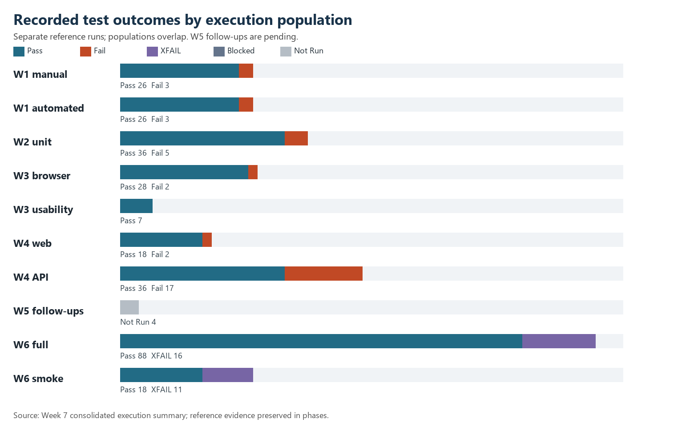
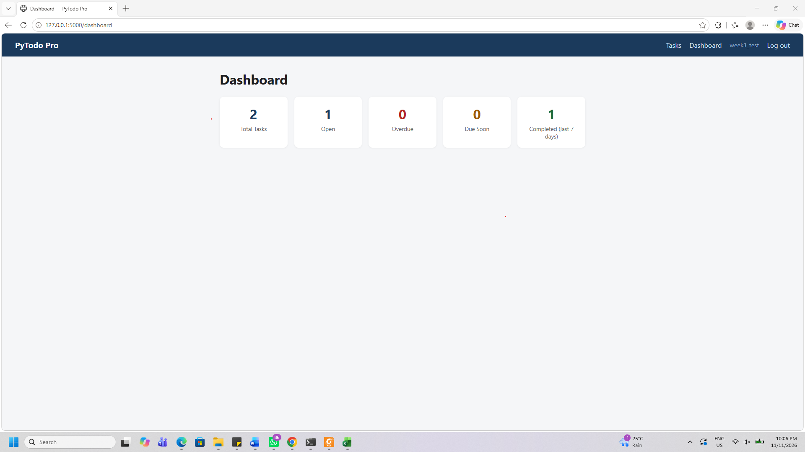
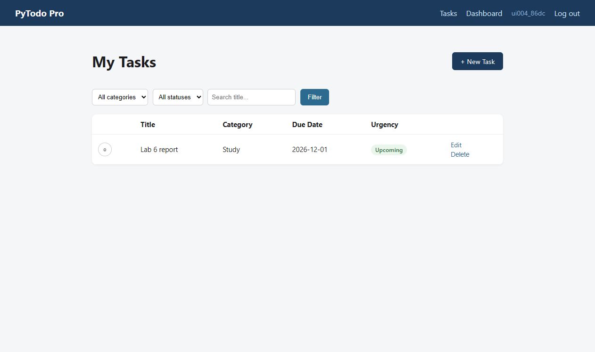
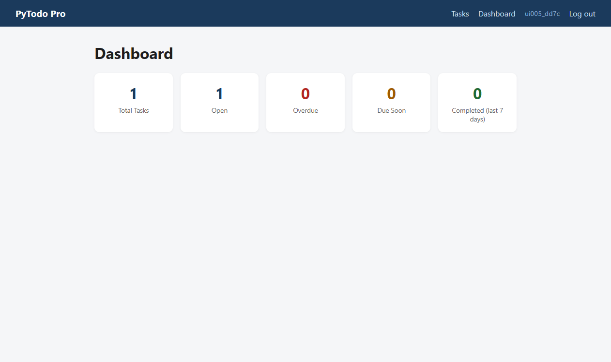
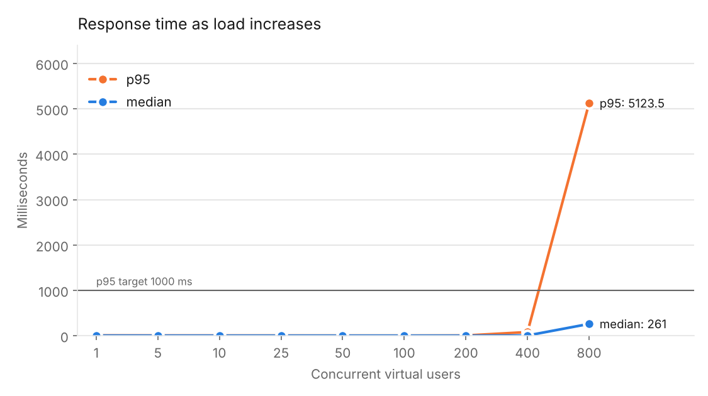
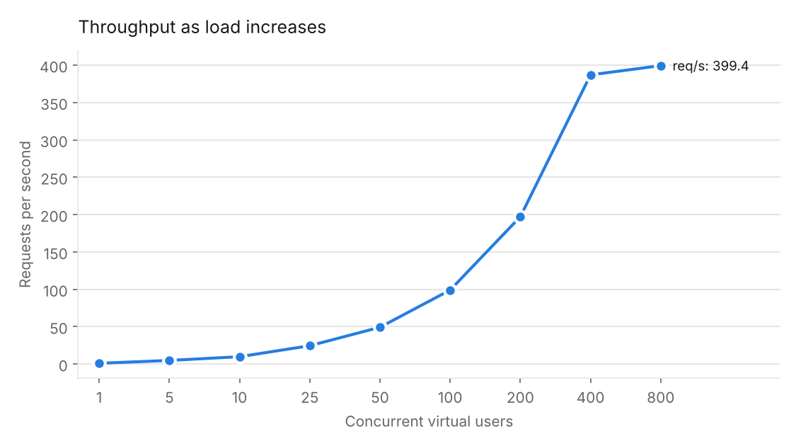
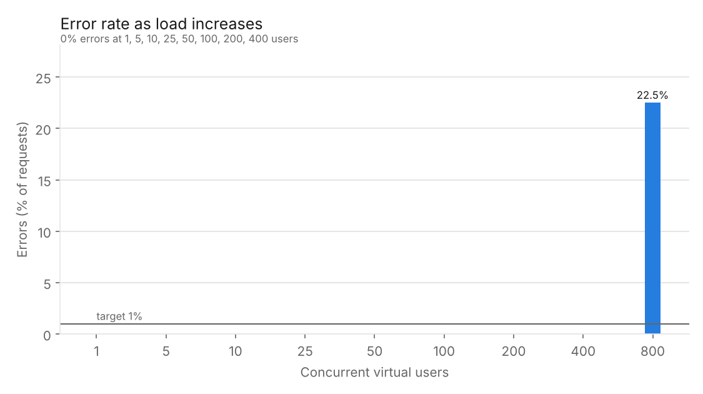

# PyTodo Pro - Week 8 SQA Metrics and Final Quality Evaluation

**Course:** TEB3433 / TFB3433 Software Testing and Quality Assurance  
**Project:** PyTodo Pro quality evaluation  
**Prepared from:** Week 1–6 reports, test evidence and Week 7 consolidation

## 1. Overall evaluation

The test results show that many of the selected main workflows work under the conditions we tested. However, there are still issues with access control, validation, date handling, accessibility, API behaviour and database writes under load. The most serious finding is that a signed-in user was able to delete another user's task through an API request during an isolated check.

The results only represent the cases, functions, environments and workloads covered by our testing.

## 2. Test execution metrics

| Phase | Executed | Pass | Fail / XFAIL | Pass rate |
|---|---:|---:|---:|---:|
| Week 1 black-box | 29 | 26 | 3 Fail | 89.66% |
| Week 2 white-box | 41 | 36 | 5 Fail | 87.80% |
| Week 3 GUI/compatibility/accessibility | 37 | 35 | 2 Fail | 94.59% |
| Week 4 web | 20 | 18 | 2 Fail | 90.00% |
| Week 4 API | 53 | 36 | 17 Fail | 67.92% |
| Week 6 full regression | 104 | 88 | 16 XFAIL | 84.62% PASS |
| Week 6 smoke | 29 | 18 | 11 XFAIL | 62.07% PASS |
| Week 5 security reviews | 4 reviews | 4 completed | Findings recorded | Not a pass/fail test count |

### Metrics charts

The charts below visualise the recorded results from the table. Week 6 XFAIL cases are shown as non-pass counts for comparison, but they are expected failures for known issues and are not equivalent to ordinary failed tests.

**Calculation:** pass rate = passed cases divided by executed cases. Week 6 XFAIL is reported separately because it means the test failed as expected for a known issue. It is not the same as a normal fail and is not a count of unique defects.

## 3. What the results tell us

- **Week 1:** 26 out of 29 black-box cases passed. The failures were related to the password minimum, due-today urgency and a whitespace-only title. The title expectation still needs confirmation.
- **Week 2:** 36 out of 41 helper tests passed. The selected helper module reached 100% statement and branch coverage, but five assertions still failed. Coverage shows which code was exercised; it does not guarantee correct behaviour.
- **Week 3:** 35 out of 37 checks/observations passed. The two accessibility findings are recorded in the defect log. Manual usability observations are different from automated browser checks.
- **Week 4:** 18/20 web checks passed. For API, 36/53 passed. The 17 failures include ownership/robustness checks and checks based on assumptions/design expectations. They should not all be reported as confirmed defects.
- **Week 6:** Full regression runs recorded 88 PASS and 16 XFAIL, with matching outcomes on the reference Linux and Windows runs. This gives us repeatability for the selected tests. The XFAIL marker is broad, so the reason for each expected failure still needs to be reviewed.
- **Week 5:** All four security-control/source reviews were completed, and their findings were documented. The performance results are limited to the recorded workloads. High-concurrency results were affected by connection failures and database contention.

### Selected evidence from earlier testing weeks

The screenshots below are selected from the evidence folders in the project repository. They are examples of the recorded testing evidence and do not replace the complete evidence folders.

*Figure: Dashboard summary captured during Week 3 GUI testing.*

*Figure: Task creation with category and due date during a Week 6 regression run.*

*Figure: Login behaviour check from the Week 6 regression run.*

*Figure: Marking a task done and reopening it during regression testing.*

## 4. Coverage and automation

### 4.1 Coverage

Week 2 recorded **100% statement coverage and 100% branch coverage** for the selected helper module/four functions. This is not coverage of the full application. Routes, database behaviour, ownership checks, GUI, API, security, compatibility and performance were outside that measured scope. The five failing assertions also show why coverage should not be treated as a correctness score.

### 4.2 Regression automation

The Week 6 full suite contained 104 tests: 41 unit, 34 API, 21 web and 8 Selenium browser tests. The recorded full results were 88 PASS and 16 XFAIL. Linux runs took 17.8 and 18.9 seconds, while the Windows run took 49.4 seconds and had the same case outcomes. The fast/no-browser run had 82 PASS and 14 XFAIL out of 96 tests. The smoke suite had 18 PASS and 11 XFAIL out of 29 in the later run.

The automation helped us repeat boundary checks, run tests across different layers and check whether changes affect known defects. The simulated fix experiment for the password issue produced four XPASS signals, while the simulated regression experiment produced three failures. These were experiments in a temporary copy and did not fix the supplied application.

## 5. Defect summary

The consolidated log contains 11 defect IDs from Weeks 1–5. They cover the following areas:

| Area | Related defects / findings | What it means |
|---|---|---|
| Password validation | DEF-W1-001 | Minimum password boundary does not behave as expected |
| Date logic | DEF-W1-002, DEF-W2-001 | Due-today and exact completion-age boundaries need correction/confirmation |
| Access control | DEF-W1-003 | Another user's task can be deleted through the API; high impact |
| Input validation/API robustness | DEF-W1-004, DEF-W4-001–003 | Blank/invalid inputs and API edge cases require handling; some expectations need confirmation |
| Accessibility | DEF-W3-001/002 | Contrast and label association findings remain |
| Performance/reliability | DEF-W5-001 | Concurrent writes can produce database-lock errors |
| Security source review | CR-01–CR-08 | Source-review findings are tracked separately from runtime defects |

The 17 Week 4 API failures are not automatically 17 defects. Some assertions depend on assumptions that still need to be agreed. Duplicate usernames and whitespace-only titles also need formal requirement confirmation.

## 6. Remaining risks

| Risk | Evidence | Risk/action |
|---|---|---|
| Cross-user task deletion | DEF-W1-003 isolated API evidence | High priority: retest ownership enforcement across API operations |
| Password minimum mismatch | DEF-W1-001 | Retest the boundary after any change |
| Date classification/boundary | DEF-W1-002 and DEF-W2-001 | Confirm inclusive/exclusive rules and retest with fixed dates |
| Blank/invalid input | DEF-W1-004 and DEF-W4 findings | Confirm expectations and validate server-side behaviour |
| Accessibility | DEF-W3-001/002 | Improve contrast and label associations; broaden checks |
| Concurrent database writes | DEF-W5-001 | Investigate locking and error handling; repeat controlled tests |
| Security source-review findings | CR-01–CR-08 | Address findings and add runtime checks where needed |
| Browser/device coverage | Week 3 test scope | More browser versions, physical mobile and assistive-technology testing |
| Application coverage | Week 2 measured scope | Coverage is limited to the selected helpers; additional structural testing may be useful |

### Performance evidence charts

These charts are taken from the combined Week 5 performance evidence run in the project repository. They are included as visual evidence of the recorded workload results; the limitations described above still apply.

*Figure: Response time versus concurrent users.*

*Figure: Throughput versus concurrent users.*

*Figure: Error rate versus concurrent users.*

The risk levels are qualitative judgements based on impact and available evidence, not calculated probabilities.

## 7. Quality assessment

This is an informal assessment using selected quality areas, not a formal ISO/IEC 25010 audit.

| Quality area | Our assessment | Limitation |
|---|---|---|
| Functional suitability | Main selected workflows generally work, but date/password/input issues remain | Only selected cases were tested |
| Reliability | Regression outcomes were repeatable; database locking was observed under load | Does not represent production reliability |
| Security | Ownership issue is a significant concern; source-review findings are documented | No uncontrolled penetration testing |
| Usability | Some browser checks and seven manual observations were completed | Not a large user study |
| Accessibility | Two findings remain | Basic selected checks only, not full conformance testing |
| Performance | Some controlled runs showed low response times; high concurrency had client errors and DB locking | Limited workload and machine |
| Compatibility | Selected browser/viewport checks were performed | No full device/browser matrix |
| Maintainability/testability | Test repositories and runners help repeat the work | No full maintainability review |

## 8. Limitations of this evaluation

- Test cases from different weeks overlap and do not represent a unique combined population.
- Week 2 coverage only applies to the selected helper module and functions.
- Some Week 4 failures depend on assumptions that need confirmation.
- Duplicate usernames and spaces-only titles are not fully formalised requirements.
- All four Week 5 security-control/source reviews were completed and their findings were documented. The metrics here summarise the recorded testing work.
- Performance results are limited to the recorded setup and workload; connection failures and DB locking affected some results.
- Physical mobile, broader browser versions, screen-reader testing and full WCAG evaluation were not established.
- Some manual tester/date details and group-review confirmations still need to be checked.
- XFAIL handling in Week 6 should be reviewed to avoid hiding unrelated errors.

## 9. Recommended next steps

1. **Priority 1 – Access control:** Retest and address task ownership checks for API read/update/delete operations, especially DEF-W1-003.
2. **Priority 1 – Security findings:** Review and address the documented Week 5 source-review findings. Add runtime verification where the team or lecturer expects it.
3. **Priority 1 – Validation:** Confirm the expected password boundary and blank-title behaviour, then update tests and defect statuses.
4. **Priority 2 – Date logic:** Confirm date-boundary rules and retest the due-today and exact-N-day issues.
5. **Priority 2 – Accessibility:** Improve contrast and labels and expand the checks to keyboard/focus and assistive technology.
6. **Priority 2 – Performance:** Investigate database locking and repeat controlled tests with client-side connection errors separated from server errors.
7. **Priority 2 – Regression:** Narrow XFAIL handling so unrelated exceptions are not treated as expected.
8. **Priority 3 – Traceability and coverage:** Keep test IDs, defect IDs and RTM entries consistent; add more tests where risk justifies them.
9. **Priority 3 – Compatibility:** Extend browser and physical-device coverage.

## 10. Conclusion

Based on the testing we completed, PyTodo Pro can perform many of the selected core workflows, and the automated regression work gives us a repeatable way to check them. However, the access-control issue, other validation/date defects, accessibility findings, API failures and database-lock behaviour still affect confidence in the application. We therefore consider the quality to be **partially demonstrated for the tested scope, with significant risks remaining**. The main areas to address first are access control, the documented security findings, validation, date logic, accessibility and reliability under concurrent writes.
